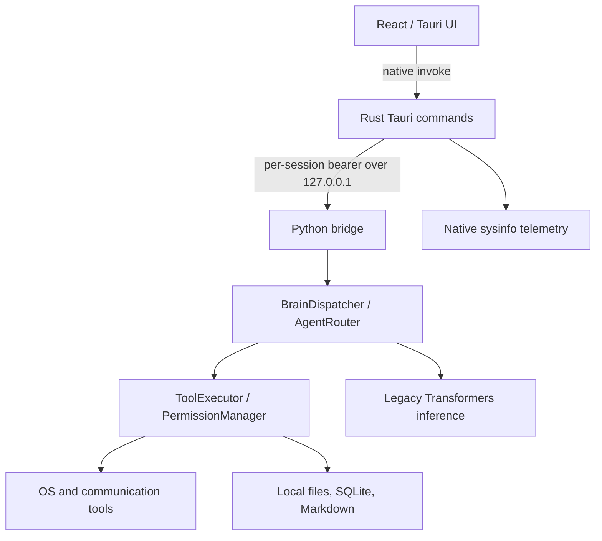
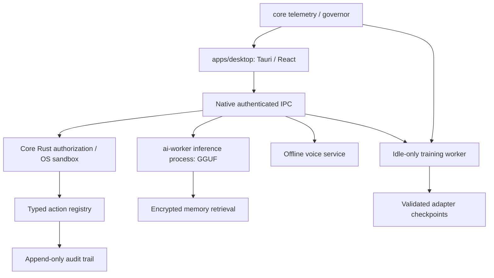

# AURIX architecture (current and target)

AURIX is the product. LUNA is the assistant persona. The currently implemented source tree is a mixture of older LUNA and AURIX modules; it has not been reorganized into the target monorepo yet.

## Current runtime



The worker is currently a Python process that Rust starts from a development source checkout. It is not yet bundled in a standalone installer. Tool execution is serialized, and model inference can still block the worker request queue. The voice UI and live training status are incomplete.

## Target architecture (planned; not implemented)



Proposed organization, not yet present:
```
apps/desktop/    Tauri + React
core/            Native Rust governor, policy, sandbox, telemetry
ai-worker/       Python inference/training/voice orchestration
models/          Local model registry and verified installers
docs/            Security, architecture, capability and operator docs
tests/           Native integration/security and performance tests
installer/       Signed desktop sidecar and MSI/NSIS workflow
```

We deliberately retain the existing files until the code migration and build pipeline can be tested incrementally. Moving folders alone is not an architectural fix.

## Design constraints
No model-generated OS action bypasses the native policy engine. Background AI work must have an independent resource budget and bounded queue. Personal data and model weights belong outside the repository and must have opt-in retention. Telemetry is actual measured data, with unobservable values represented as unavailable. Local/offline network policy requires enforcement by software, not just an LLM prompt.
