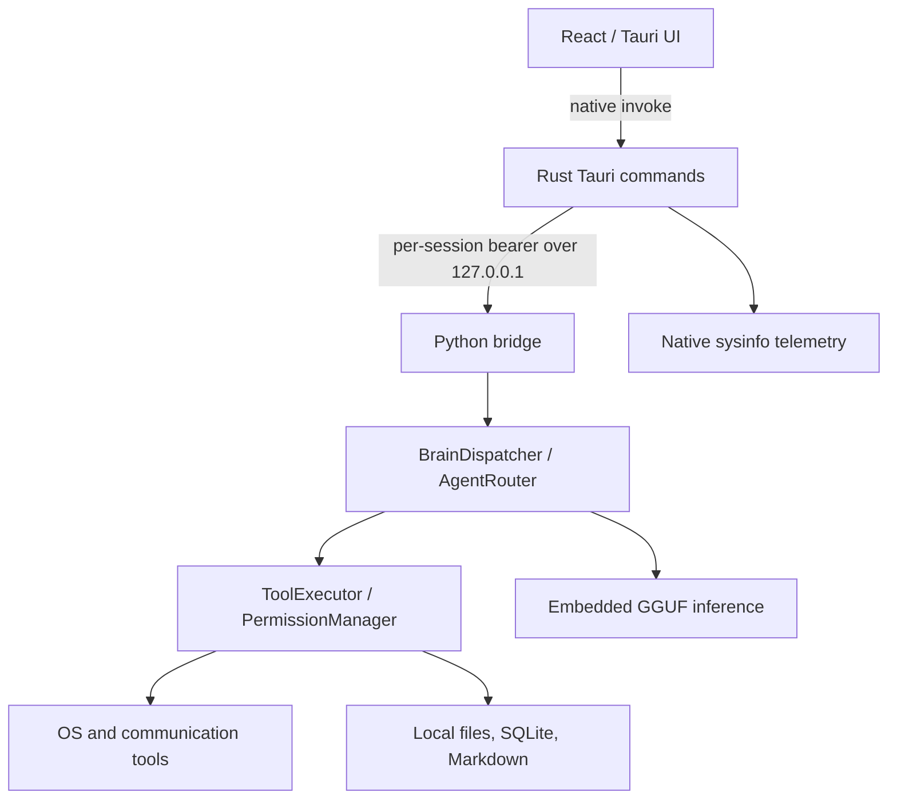
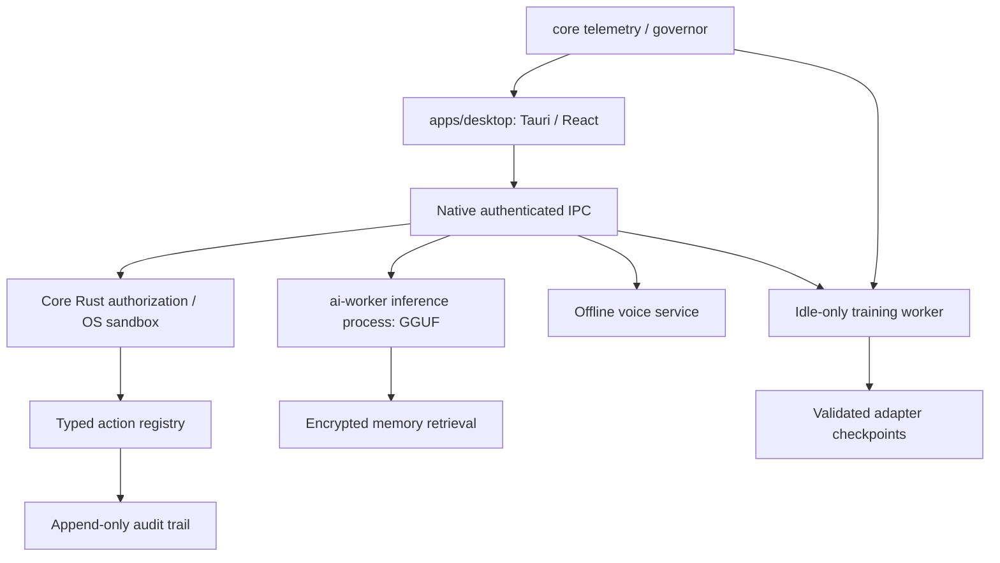

# AURIX architecture (current and target)

AURIX is the product. LUNA is the assistant persona. The currently implemented source tree is a mixture of older LUNA and AURIX modules; it has not been reorganized into the target monorepo yet.

## Current runtime



The release worker is packaged with PyInstaller and launched beside the installed desktop executable. Source-checkout discovery is debug-only. Dispatch is serialized with immediate busy rejection rather than a delayed action queue. Independent request threads handle health and emergency controls. Windows installer validation remains a release gate; see RELEASE_READINESS.md.

## Target architecture (planned; not implemented)



Proposed organization, not yet present:
```
apps/desktop/    Tauri + React
core/            Native Rust governor, policy, sandbox, telemetry
ai-worker/       Python inference/training/voice orchestration
models/          Local model registry and verified installers
docs/            Security, architecture, capability and operator docs
tests/           Native integration/security and performance tests
installer/       Signed desktop sidecar and MSI/NSIS workflow
```

We deliberately retain the existing files until the code migration and build pipeline can be tested incrementally. Moving folders alone is not an architectural fix.

## Design constraints
Target requirement: no model-generated OS action may bypass a native policy engine. The current policy engine is Python and does not yet meet that requirement. Background AI work must have an independent resource budget and bounded queue. Personal data and model weights belong outside the repository and must have opt-in retention. Telemetry is actual measured data, with unobservable values represented as unavailable. Local/offline network policy requires enforcement by software, not just an LLM prompt.

## Native telemetry history (added)

The Tauri Rust sampler emits `aurix://telemetry` events every three seconds while running and records system-level metrics through `frontend/src-tauri/src/telemetry_store.rs` to local SQLite. Raw data is pruned after one day, minute averages after thirty days; hourly aggregates are retained. UI history is offered over fixed 1h, 24h, and 7d windows. This is independent of the Python model runtime. The GPU metrics are whole-device NVML readings, not AURIX-only memory use.
